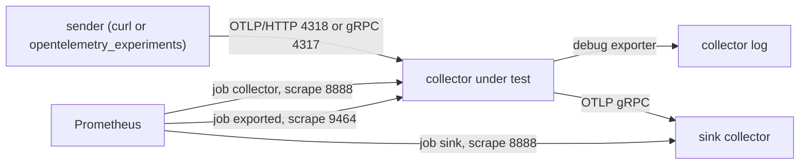

# Method

## The rules

1. A hypothesis is written into `QUESTION.md` before the first run and is
   never edited afterwards. It stays next to what happened, including when it
   was wrong, and the "Result" section says plainly which predictions failed.
   The repository does not prove the order of writing and running, so the
   discipline is the author's: a hypothesis edited after the run is the one
   thing this repository cannot recover from.
2. Every question names the paragraph of the official documentation it tests,
   with the URL pinned to a tag or commit, the line numbers, and the sentence
   quoted verbatim. The `QUESTION.md` records the `curl | grep` that confirmed
   the text at that reference. A question whose answer is already written in
   the documentation, without ambiguity, does not belong here.
3. Three repetitions by default. A question that needs fewer or more says why
   in its own file. A question whose variants share a drifting resource, such
   as CPU on the Docker Desktop VM, sets `Question.rotate_variants`: repetition
   r starts at variant r, every run records its `position`, and `results.json`
   records `execution_order`. Balance takes as many repetitions as variants,
   so that each variant runs once in each position: four in L3-06, five in
   L1-04.
4. Every number comes from a self-metric, a Prometheus query, or a recorded
   HTTP response. A number typed from memory is an assumption and is labelled
   as such in the same sentence.
5. Each result says, in one sentence, what it does to a dashboard, an alert or
   a bill, and one sentence on what it does not say.
6. `LEARNINGS.md` accepts only sentences that link the `results.json` behind
   them.
7. No Grafana, no "full observability stack". Tables in Markdown.

## The stack



The default stack is three containers, defined in
[`compose.yaml`](../compose.yaml). A question that sets
`Variant.gateway_config` also starts the `gateway` service (compose profile
`gateway`), in order sink, gateway, collector, Prometheus. A question that
sets `Variant.collector_image` runs that image instead of the stock
`otelcol-contrib` build; `COLLECTOR_DOCKERFILE` and
`COLLECTOR_BUILD_CONTEXT` select the Dockerfile.

| Service | What it is | Host ports |
| --- | --- | --- |
| `collector` | the collector under test, config swapped per variant | 24317 gRPC, 24318 HTTP, 28888 self-metrics, 29464 Prometheus exporter, 23133 health check |
| `gateway` | optional middle collector, profile `gateway` | 24327 gRPC, 24328 HTTP, 28890 self-metrics, 23135 health check |
| `sink` | a second `otelcol-contrib` whose `otelcol_receiver_accepted_*` is the answer to "what arrived" | 28889 self-metrics, 23134 health check |
| `prometheus` | scrapes both collectors' self-metrics (jobs `collector` and `sink`) and the collector's `prometheus` exporter (job `exported`) every second | 29090 |

Everything binds to `127.0.0.1`. Containers run read only, with `ALL`
capabilities dropped and `no-new-privileges`.

The sink reads [`config/sink.yaml`](../config/sink.yaml), whose `debug`
exporter runs at `verbosity: basic` and prints one summary line per export
request. A question that needs to see every record arriving points
`Variant.sink_config` at [`config/sink-detailed.yaml`](../config/sink-detailed.yaml)
instead. Both sink configs set `service::telemetry::logs::sampling::enabled` to
false, so the sink's log is a count and not a floor; the collector under test
keeps the sampling defaults, because they are part of what the questions
measure. `opentelemetry_experiments.core.debuglog` reads both shapes:
`export_requests` returns the item count of each request, which is the batch as
it crossed the wire, and `spans_by_trace`, `parents_by_span`, `log_bodies` and
`log_attributes` read the records printed at `detailed`.

The collector also mounts a directory at `/input`, read only, so a receiver
that reads files has something to read. It defaults to
[`config/input`](../config/input) and `Variant.input_directory` points it at a
question's own directory. The files a question writes there are not tracked.

`docker compose pause sink` and `docker compose stop sink` are the two fault
conditions. Pause keeps the TCP connection open and stops reading, stop closes
it. Level 0 already uses stop, once, in L0-03's `sink-stopped` variant; pause
appears from level 2 on. Every run saves both collectors' logs under
`results/logs/`, and the `measure` functions of level 0 parse only the
collector's.

A question that measures memory pressure sets `Variant.collector_memory_limit`
(for example `"512m"`). The runner passes it to `stack.environment`, which sets
`COLLECTOR_MEM_LIMIT`, and `compose.yaml` applies it as the collector's
`mem_limit`; the default `"0"` means no ceiling. `stack.container_state` reads
the collector's `running`, `OOMKilled` and restart count from `docker inspect`,
so a question can invalidate a run in which the kernel killed the process
instead of the processor shedding load.

A question that measures an application SDK runs the SDK in its own Python
process, so no provider or exporter state leaks into the harness. L2-06 does
this with a question-local `emitter.py` that stops and starts the collector
itself with `docker compose stop collector` and `start collector`, and prints
one JSON line the question parses. Restarting the collector resets its self
counters; the sink, which keeps running, is then the cumulative count. L3-03
uses the same pattern with a deterministic id generator, so every repetition
emits the same trace ids and a head sampler selects the same traces. L3-05
reuses that emitter shape and adds a unique `customer.id` per trace, so the
spanmetrics series count is fixed by the workload. L4-02 uses the same
emitter shape for the metrics SDK: a View with `attribute_keys` is compared
to a Collector `aggregate_on_attributes`, and a count connector on a
pre-transform fan-out proves whether `user.id` still reached the platform.
L4-03 serves vendored semantic-convention schema files from a local HTTP
server on the host, recreates only the Collector between a historical
pass-through batch and a live schema-processor batch, and treats the sink's
append-only log as history. `otlp.trace_payload(..., schema_url=...)` and
`debuglog.span_attributes` / `resource_schema_urls` support that question.
L4-01 adds the gateway hop and pauses one layer at a time. L4-05 scrapes
native histograms only when the exported job sets `scrape_native_histograms`
and negotiates protobuf. L4-04 builds a second Collector image with `ocb`
and compares it with the stock image on the same log workload.

`stop` followed by `start` restarts the sink process and resets its self
counters while preserving the container log. A question that recovers the sink
and needs a cumulative arrival count records the counter before the stop and
adds that offset to the post-restart counter. It also compares the total with
the sink's unsampled detailed log; the raw post-restart counter remains in
`counters.sink.*` as one process epoch, not as the run total.

A question that measures bytes on the wire or CPU reads the Docker Engine
directly. `stack.raw_stats(service)` asks the active context's Unix socket for
`/containers/{id}/stats?stream=false&one-shot=true` and returns cumulative
`cpu_stats.cpu_usage.total_usage` nanoseconds and per-interface `rx_bytes` and
`tx_bytes`; `stack.engine_version()` records the Engine and API versions.
`stack.counter_delta(before, after)` subtracts two readings and names any
reason they cannot be compared: a different container id, a changed set of
interfaces, or a counter that went backwards. `docker stats` percentages are
not used for this, because they are rates sampled at an unknown instant. L3-06
stops Prometheus for its window, so no scrape lands on the sink, and reads an
idle baseline first; the sink's interface still receives about 200 bytes per
second with nothing sent, so that rate is subtracted and recorded.

A question whose subject is the Collector's own command line sets
`Question.starts_stack` to false. The runner then calls `send` without
starting or stopping the stack, and reads no counters. L1-01 does this with
`stack.validate_config(path)`, which runs `otelcol validate` in a
`docker compose run --rm --no-deps collector` container and returns its exit
code, output and wall time. Configs that must fail live in a question's
`config/cases/`, outside the `questions/*/config/*.yaml` glob that
`just validate` checks.

## Dependent variables

Every question records these, whether or not it reports them:

| Field | Where it comes from |
| --- | --- |
| `sending.*` | the HTTP status and body returned by the receiver, or the gRPC status |
| `counters.collector.*` | `otelcol_receiver_accepted_*`, `refused_*`, `otelcol_exporter_sent_*`, `send_failed_*` on the collector under test |
| `counters.sink.*` | the same counters on the sink, which is what actually arrived |
| `measured.*` | what the question's `measure` function read from the two logs, the stack or Prometheus; the fields are named per question |
| `log.warn_lines`, `log.error_lines` | the collector log, counted by level |
| `validity.ok` | whether the run is usable at all |

Collector logs are sampled by default (`Initial: 10`, `Thereafter: 100`, over a
10 second tick), so `log.warn_lines` is a floor, not a count of events. Any
question that reads it says so.

`measure(variant, sending, collector_log, sink_log)` receives both logs, so a
question that puts two pipelines on one receiver can read what each side
printed. For queries, `prometheus.counters` returns the four delivery counters
for one scrape job and `prometheus.series_names(url, job)` returns every metric
name that job published, which is how a question asks what a telemetry level
costs. `stack.environment(..., extra={...})` puts variables in the collector's
environment. The runner passes `Variant.options["environment"]` to that
argument, which is how a config under test reads `${env:NAME}`.

Two derived quantities have fixed meanings across questions. Request bytes are
the body `otlp.post_json` sent, before HTTP headers; batch item bytes are
`otelcol_processor_batch_batch_send_size_bytes_sum`, the processor's sizing of
the items it emitted, which is neither a request on the wire nor stored bytes
(L3-04). A spanmetrics series is one Prometheus series of the connector's
output: each dimension combination produces one `calls` series plus, for a
histogram with six explicit buckets, seven `bucket` series, one `sum` and one
`count`, ten in all, so a series count is ten times the combination count
(L3-05).

## Validity

A run is invalid, and says why, when the collector or the sink never became
healthy, when either service log cannot be collected or is empty, when the
counters never settled, when `measure` cannot read its evidence, or when the
accepted counters disagree with the variant's `expects_acceptance`. An invalid
run is kept in `results.json` with `validity.ok` false and is excluded from the
table. A stack that never becomes healthy, which is what a config the Collector
rejects looks like, invalidates that one run and the remaining runs continue.

Two more rules apply once those pass. Every report column's path must exist in
the run: a path that is absent means the evidence was never read and the run
is invalid, while a path recorded as `None` is a measured absence, such as a
counter the Collector never published. Then `Question.validate_run(variant,
run)`, when a question defines it, returns the integrity checks that are not
table columns, for example that every sequence number sent arrived exactly
once; each sentence it returns is a validity note.

`just ask` writes `results.json` and `REPORT.md` either way, so an invalid run
can be diagnosed, and exits non-zero when any repetition is invalid. A table
with a missing repetition is not a result.

## Provenance

`results.json` carries `results_version` (2 since provenance was added; files
without it are version 1 and still render) and a `provenance` block: the
Python version, operating system and architecture, the Docker Compose version,
and the SHA-256 of `compose.yaml` and `Dockerfile.collector`. Each entry under
`variants` records its `options` and the SHA-256 of its collector, sink and
Prometheus configs, plus the gateway config when the variant sets one. No
clock reading is recorded, so two runs of the same
setup can be compared field by field.

Two flags on a variant are validity rules, not predictions, and neither is
allowed to carry an expected result:

- `expects_telemetry`, whether the collector under test publishes any
  `otelcol_*` counter at all. It is false only when self-telemetry is off or
  when the payload never reaches a component that records. When it is false,
  an all-zero reading is only believed after ten seconds of polling, because a
  counter that has not been scraped yet and a counter that will never exist
  look the same.
- `expects_acceptance`, whether `otelcol_receiver_accepted_*` should rise. It
  is false for a payload the receiver refuses.

Getting either wrong shows up as a variant whose cells all read `-`, with the
reason in the "Invalid runs" table. Correct the flag and run again. The
hypothesis in `QUESTION.md` is not touched, and a hypothesis contradicted by
the numbers stays as written.

## Pins

Resolved at write time, never from memory. The commands:

```bash
gh api repos/open-telemetry/opentelemetry-collector-releases/releases/latest --jq .tag_name
curl -sL https://github.com/open-telemetry/opentelemetry-collector-releases/releases/download/v<version>/otelcol-contrib_<version>_linux_amd64.tar.gz.sha256
docker buildx imagetools inspect prom/prometheus:<tag> --format '{{.Manifest.Digest}}'
docker buildx imagetools inspect alpine:<tag> --format '{{.Manifest.Digest}}'
curl -s https://pypi.org/pypi/<package>/json | jq -r .info.version
```

| Artifact | Pin |
| --- | --- |
| `otelcol-contrib` | `0.162.0`, tarball verified against the release `.sha256` for amd64 and arm64 |
| `alpine` (build stage only) | `3.24.2@sha256:294b683cb724975bec92580e1e685676bd4b50bda910ddb8c51d4cabeaec77e6` |
| `prom/prometheus` | `v3.15.0@sha256:efd719c99d83b060d9daefdcf00360461adf279f45ef5391f8d111892118753e` |
| Python | `3.14.*`, exact interpreter in `.python-version` |
| `pytest`, `ruff` | exact versions in the `dev` group of `pyproject.toml`, resolved in `uv.lock`; the harness itself uses only the standard library |
| `opentelemetry-sdk`, `opentelemetry-exporter-otlp-proto-http` | `1.45.0`, exact in the `dependencies` of `pyproject.toml` and resolved in `uv.lock`; imported only by questions that measure the SDK |
| `grpcio` | `1.84.0`, exact in the `dependencies` of `pyproject.toml` and resolved in `uv.lock`; L1-04 uses it with the `opentelemetry-proto` stubs to send OTLP/gRPC without an SDK exporter |

The runtime image is `FROM scratch` with the verified binary and nothing else,
so the Alpine digest is a build input and not an attack surface at run time.

The harness and recipes assume Python 3.14, Bash, and Docker on amd64 or
arm64. `stack.raw_stats` reads the Engine over a Unix socket; a Windows named
pipe is not supported. Absolute CPU and RX figures in recorded results came
from Docker Desktop on macOS and are not portable as billable numbers.

## Writing a question

```bash
just new-question L1-01 pipeline-from-zero collector
```

That copies `questions/_template/`, including a working
`config/collector.yaml` that starts as a copy of the shared debug config, and
fills in the id, level, theme and directory name. Fill `QUESTION.md` top to
bottom up to and including "Hypothesis", then run. The harness writes
`results/results.json` and `results/REPORT.md`; the author then writes
"Result" and "What this does not say" from the table, and nothing above them.
`question.py` declares the variants and two functions, `send(variant)` and
`measure(variant, sending, collector_log, sink_log)`, plus an optional
`validate_run(variant, run)` for integrity checks;
the runner owns the stack, the repetitions, the settling and the JSON. A
`send` or `measure` call that raises is recorded as an invalid run with the
exception in its notes, and the remaining runs continue.

`just check` fails when a `QUESTION.md` is missing a required field, so a
question cannot be half declared.

## External evidence

A question already measured in another repository links that result instead of
running it again. Its front matter names `evidence_repository`,
`evidence_commit` (a 40 character commit) and `evidence_results`, one or more
`results.json` URLs of the form `<repository>/blob/<commit>/...`. The lint
accepts `status: measured` only with local `question.py` and
`results/results.json`, or with all three fields pinned that way. `just ladder`
shows such a question as `external`. L3-01 and L3-02 are the two cases, backed
by the cardinality lab.

Rule 1 cannot be met after the fact: a hypothesis written with the numbers in
view is not one. An external question says so in its "Hypothesis" section and
records no prediction. Its "Result" reads only the pinned artifact.
